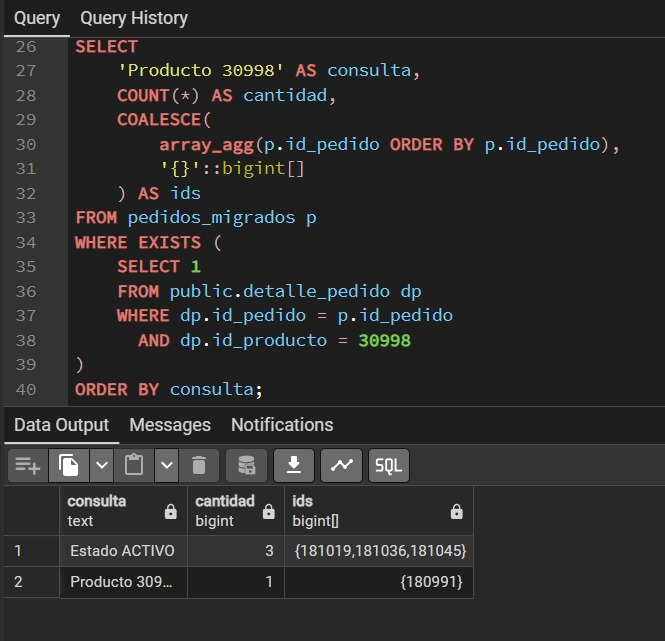

# Unidad 7 - NoSQL y nuevas formas de almacenamiento

**Proyecto:** Food Store. **Asignatura:** Bases de Datos II. **Fecha:** 06/11/2026.  
**Integrantes:** Tomas Martin, Benjamin Lagos, Santiago Prandina, Emir Gris, Leandro Rea, Brian Rampone, Joel Herrera, Octa Medina.  
**Repositorio:** [Tomimartin/BaseDeDatos2](https://github.com/Tomimartin/BaseDeDatos2).  
**Entorno:** PostgreSQL 17.11 y MongoDB 8.0.10. Origen `foodstorecopia`; destino `foodstorecopia_nosql.pedidos_u7`.

## 1. Modelo documental y correspondencia

Se seleccionaron los pedidos **180991, 181008, 181019, 181036 y 181045**, con una línea cada uno. `pedido.id_pedido` se relaciona con `detalle_pedido.id_pedido`; el cliente se identifica mediante `pedido.id_cliente` y el producto mediante `detalle_pedido.id_producto`. Sus identificadores originales se conservan en los documentos.

| Campo | Tipo MongoDB | Correspondencia |
|---|---|---|
| pedido_id | Long | Conserva pedido.id_pedido. Índice único. |
| fecha / fecha_origen_pg | Date / string | Fecha UTC consultable y valor PostgreSQL completo. |
| estado / eliminado | string / boolean | ACTIVO=false; ELIMINADO=true, por baja lógica. |
| forma_pago | string | Valor original del enum relacional. |
| cliente | objeto embebido | ID original, alias público y marca de anonimización. |
| items | arreglo de objetos | ID/nombre de producto, cantidad y precio histórico. |
| precio_unitario / subtotal / total | Decimal128 | Importes decimales; total = suma de líneas. |

El cliente y las líneas se embeben porque se consultan junto al pedido completo. El alias `Cliente ID` evita incluir nombres o correos personales; el ID del cliente se conserva. Los precios provienen de `detalle_pedido.precio_unitario`, no del precio actual del catálogo. [1, 3]

El esquema real tiene `eliminado` y carece de un estado de entrega. En esta implementación **`estado` representa la vigencia por baja lógica**: `ACTIVO` cuando `eliminado=false` y `ELIMINADO` cuando `eliminado=true`. Se conserva el booleano original y PostgreSQL aplica la misma correspondencia mediante `CASE`.

BSON Date tiene precisión de milisegundos. Para conservar el valor completo de PostgreSQL, incluidos microsegundos y zona horaria, se guarda además `fecha_origen_pg`. Los importes se representan con Decimal128. [5, 6]

Ejemplo reproducido desde el script ejecutado y el CSV que se verificó durante la migración:

```javascript
{
  pedido_id: NumberLong("180991"),
  fecha: ISODate("2026-01-31T04:19:57.926Z"),
  fecha_origen_pg: "2026-01-31 01:19:57.926064-03",
  estado: "ELIMINADO", eliminado: true, forma_pago: "TARJETA",
  cliente: { cliente_id: NumberLong("18492"),
    nombre_publico: "Cliente 18492", anonimizado: true },
  items: [{ producto_id: NumberLong("30998"),
    nombre_producto: "Producto generado 30998", cantidad: NumberInt(11),
    precio_unitario: NumberDecimal("1350.33"),
    subtotal: NumberDecimal("14853.63") }],
  total: NumberDecimal("14853.63")
}
```

## 2. Migración, integridad y consultas

Se exportaron las filas reales desde PostgreSQL a [CSV](evidencias/pedidos_postgresql_origen.csv). El script [consultas_mongodb.js](consultas_mongodb.js) crea la colección del laboratorio y reemplaza o incorpora los cinco IDs con `bulkWrite` y `replaceOne`, usando `upsert`. Un índice único impide duplicar `pedido_id`.

La ejecución se realizó pegando el código completo en la consola integrada: su función `load()` no estaba implementada. La versión entregada utiliza esa modalidad y muestra los resultados en pantalla.

Reglas de integridad conservadas y comprobadas:

1. Cantidades positivas y precios no negativos. El esquema exige los tipos numéricos previstos.
2. Total igual a la suma de cantidad × precio histórico de sus líneas. Se valida en el documento y mediante consulta posterior.
3. ID de pedido único y estado coherente con `eliminado`.

Las cuatro consultas se ejecutaron sobre el mismo subconjunto:

```javascript
const pedidos = db.getSiblingDB("foodstorecopia_nosql")
  .getCollection("pedidos_u7");
const ids = [180991, 181008, 181019, 181036, 181045]
  .map(id => NumberLong(String(id)));
const alcance = { pedido_id: { $in: ids } };

// a) Todos, con identificador y estado.
pedidos.find(alcance, { _id: 0, pedido_id: 1, estado: 1 });
// b) Estado existente en los documentos.
pedidos.find({ ...alcance, estado: "ACTIVO" });
// c) Producto dentro del arreglo de lineas.
pedidos.find({ ...alcance, "items.producto_id": NumberLong("30998") });
// d) Total superior al umbral elegido.
pedidos.find({ ...alcance, total: { $gt: NumberDecimal("10000.00") } });
```

El umbral **10000** distingue el pedido de total **7.120,15** de los otros cuatro. Es una elección del laboratorio, no una regla comercial general.

| Consulta MongoDB | Cantidad observada | IDs observados |
|---|---:|---|
| a) Todos | 5 | 180991, 181008, 181019, 181036, 181045 |
| b) Estado ACTIVO | 3 | 181019, 181036, 181045 |
| c) Producto 30998 | 1 | 180991 |
| d) Total > 10000 | 4 | 180991, 181008, 181019, 181036 |

El resultado fue **EXITO** el **06/11/2026 16:44:09 (-03:00)**, equivalente a `2026-11-06T19:44:09.164Z`. Se verificaron cinco documentos contra el origen: **0 pedidos con ítems inválidos** y **0 totales inconsistentes**. Véanse [la salida aportada](evidencias/mongodb_salida_20261106_194409.txt) y [el resultado JSON](evidencias/resultado_mongodb_20261106_194409.json).

## 3. Verificación con PostgreSQL

Las [consultas PostgreSQL](consultas_postgresql.sql) utilizan los cinco IDs migrados. El estado se obtiene con `CASE` desde `eliminado`; el producto se comprueba con `EXISTS` sobre `detalle_pedido`. La consulta por producto incluye pedidos activos y eliminados en ambos motores.

| Consulta | Cantidad PostgreSQL | IDs PostgreSQL | Cantidad MongoDB | IDs MongoDB | Coinciden |
|---|---:|---|---:|---|---|
| Estado ACTIVO | 3 | 181019, 181036, 181045 | 3 | 181019, 181036, 181045 | Sí |
| Producto 30998 | 1 | 180991 | 1 | 180991 | Sí |

La [captura de ejecución PostgreSQL](evidencias/03_comparacion_postgresql.png) muestra ambas filas. La búsqueda del producto `30998` recupera únicamente `180991` en este subconjunto; `181019` contiene realmente el producto `31026`.

Datos del origen conservados en la migración:

| Pedido | Estado | Cliente ID | Producto ID | Cantidad | Precio histórico | Total |
|---|---|---:|---:|---:|---:|---:|
| 180991 | ELIMINADO | 18492 | 30998 | 11 | 1.350,33 | 14.853,63 |
| 181008 | ELIMINADO | 2412 | 31015 | 8 | 4.384,97 | 35.079,76 |
| 181019 | ACTIVO | 4790 | 31026 | 19 | 3.544,59 | 67.347,21 |
| 181036 | ACTIVO | 13628 | 31043 | 16 | 3.324,05 | 53.184,80 |
| 181045 | ACTIVO | 4026 | 31052 | 5 | 1.424,03 | 7.120,15 |



## 4. Evaluación de tecnología y verificación de IA

**Herramienta:** Codex. **Consulta guía aplicada en esta revisión:**

> Compará PostgreSQL y MongoDB para Food Store. El modelo relacional tiene pedido, detalle_pedido, producto y cliente; se consultan pedidos completos con frecuencia y se deben conservar cantidades y precios históricos. Evaluá embeber cliente e ítems, la atomicidad, la coherencia del stock y el costo de mantener dos motores. Diferenciá ventajas de diseño de afirmaciones de rendimiento que requieren mediciones.

**Síntesis de la respuesta de IA:** PostgreSQL resulta adecuado como fuente transaccional del negocio. MongoDB permite agrupar cliente e ítems para leer pedidos completos. Una copia del precio histórico conserva el valor migrado, pero necesita reglas de actualización. La ventaja de rendimiento debe comprobarse con una carga comparable.

Se contrastaron dos afirmaciones del informe asistido por IA anterior:

**1. Incrustar el precio garantiza su inmutabilidad.** Corregida: la copia histórica es independiente del catálogo, pero puede actualizarse. En el laboratorio se comprobó la igualdad de precios con PostgreSQL; no se implementó una prohibición general de cambios. Referencias [2, 3].

**2. PostgreSQL necesariamente tiene más latencia por usar JOINs.** No demostrada: embeber permite una operación de base de datos, sin garantizar una única lectura física ni menor tiempo. No se midieron latencias comparables en este ensayo. Referencias [1, 4].

Las escrituras sobre un documento son atómicas en MongoDB. Eso no convierte las cinco operaciones del lote en una única transacción ni resuelve automáticamente la consistencia con un catálogo separado. [2]

## 5. Conclusión técnica

Para Food Store conviene mantener PostgreSQL como fuente transaccional principal: sus relaciones y restricciones permiten coordinar clientes, pedidos, detalles y stock. MongoDB es adecuado para una representación de lectura de pedidos completos, con cliente e ítems embebidos y una actualización atómica por documento. Este laboratorio verificó correspondencia de datos y resultados para cinco pedidos, pero no midió una ventaja de rendimiento. Combinar motores agregaría trabajo de sincronización y control de consistencia. Por eso, una proyección MongoDB debería adoptarse cuando exista una necesidad de lectura concreta y una mejora medida que justifique ese costo. Los precios históricos deben conservarse desde detalle_pedido y protegerse mediante reglas de actualización, cualquiera sea el motor elegido.

## Referencias oficiales

1. [Datos embebidos en MongoDB](https://www.mongodb.com/docs/manual/data-modeling/embedding/).
2. [Atomicidad y transacciones](https://www.mongodb.com/docs/manual/core/write-operations-atomicity/).
3. [Datos duplicados e históricos](https://www.mongodb.com/docs/manual/data-modeling/best-practices/).
4. [PostgreSQL: planes y EXPLAIN](https://www.postgresql.org/docs/17/using-explain.html).
5. [Tipos de datos de mongosh](https://www.mongodb.com/docs/mongodb-shell/reference/data-types/).
6. [Extended JSON y precisión de fechas](https://www.mongodb.com/docs/manual/reference/mongodb-extended-json/).

## Evidencias y trazabilidad

- [CSV original](evidencias/pedidos_postgresql_origen.csv), hash SHA-256 `cb3a7f6ab08d26da3ecaef9fc9c6ca60338db2394f381455aa2b06adb7fa1ff1`.
- [Resultado MongoDB](evidencias/resultado_mongodb_20261106_194409.json) y [salida de consola](evidencias/mongodb_salida_20261106_194409.txt), transcritos del texto aportado por el equipo.
- [Comparación PostgreSQL](evidencias/03_comparacion_postgresql.png) y [transcripción CSV de la captura](evidencias/comparacion_postgresql_transcrita.csv).
- [Estructura real de pedido](evidencias/01_estructura_pedido_postgresql.png) y [selección del origen](evidencias/02_pedidos_origen_postgresql.png).
- El archivo de documentos preparados y los resultados esperados se identifican como datos derivados del CSV, diferenciados de las evidencias de ejecución.
